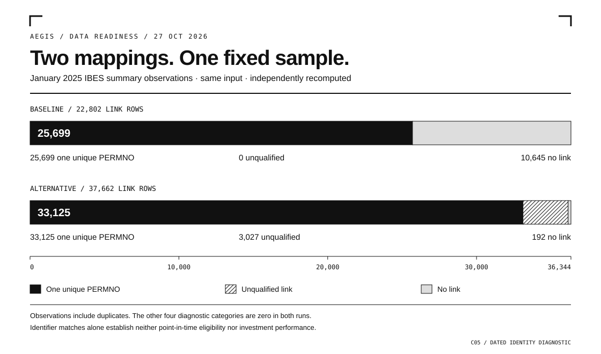

# Beta V2 build batch 7: joins, completion and the owner view

The approved Blackline design is preserved. This batch adds independently reviewed
substeps; no parent workstream or production adoption is certified.

| Workstream | Completed substep | Remaining boundary |
|---|---|---|
| C03 | The bridge read the existing benign test turn and marked its original synthetic checkpoint COMPLETED. Independent review verified exactly five permitted changes and thirteen preserved values. | Real-owner Telegram ingress/delivery and runtime adoption remain open. No new model turn or message was sent. |
| C04 | The isolated shutdown-race repair passed independent review: 123 synthetic executions. The next pure framing/transcript component passed 23 tests. | The framing output is data only. Authentication, live startup, normal exit and installer/carry integration remain unfinished. The active reader is untouched. |
| C05 | Two existing identifier maps were tested against the same 36,344 January 2025 observations, with independent full aggregate recomputation. | Resolve mapping provenance and uncertain identifiers/intervals before point-in-time or named research use. |
| C02 | Forecast warning wording now describes observed calendar-day counts without inferring a stopped producer. Seven focused tests and independent review pass. | The edit is local; statuses, thresholds, counts and UNKNOWN behavior are unchanged. |
| C14 | The Blackline cockpit preserves 146 requests, 17 workstreams and 28 hypotheses. Desktop rendering, mobile stacked fields, keyboard access and source clocks were checked independently. | It is a dated planning snapshot, not live telemetry or full-workstream acceptance. |

## What the data check found

| Classification | Baseline map | Alternative existing map | Change |
|---|---:|---:|---:|
| One unique PERMNO | 25,699 | 33,125 | +7,426 |
| No link | 10,645 | 192 | -10,453 |
| Unqualified link | 0 | 3,027 | +3,027 |
| Each of the other four categories | 0 | 0 | 0 |

PERMNO is the CRSP security identifier. These are observations, including
duplicates, rather than unique companies. The 3,027 unqualified observations
split into 2,944 affected by uncertain interval ends and 83 by missing PERMNOs
under the conservative consumer rules. We did not fill missing dates or discard
the affected rows to improve the match rate.

The baseline acquisition manifest records a PERMNO-universe filter. Its smaller
coverage alone therefore does not demonstrate a failed download. The larger
map's metadata has a documented stale universe label. Current metadata/source
policy does not recover the exact historical query, universe and extraction
binding. Neither map is newly qualified for point-in-time use or investment
performance. No data was downloaded for this comparison.

## Delivered and preserved

The approved 28-page Blackline PDF remains unchanged. Its status cutoff is still
26 October 15:49 UTC; this later progress is recorded separately. The new
[Blackline cockpit](C:/Users/mrthn/Downloads/AEGIS_OWNER_COCKPIT_2026-10-27_BLACKLINE.html)
uses the registry snapshot captured at 18:26 UTC. The dated
[Downloads archive](C:/Users/mrthn/Downloads/AEGIS_ARCHIVE_2026-10-26/INDEX.html)
now contains 155 verified copies. Originals and all prior 154 records remain.

Reviewed source chunks are saved on the existing isolated Git branch; nothing
was pushed or deployed in this batch. Hosted GitHub jobs still fail before any
step because the annotation reports a payment failure or spending-limit issue.
It does not establish a storage limit. Local work required no new paid plan.

The final read-only production check still reports all twelve scheduled jobs
registered and all ten NAV lanes fresh for the expected 23 October date. The
25 overdue forecasts, unavailable IC funnel and calendar-window accrual warning
remain open. Paper accounts, NAV/history and scheduled services were not changed.
DeepSeek's staged replacement has not been applied; other recorded credential
rotation gates remain pending. The retired hack3 slot is not a repair target.

## Next bounded work

Continue C04 B2/B3 from the frozen authentication/startup packet, then the separate
native-exit and installer/carry steps. No Watch, STOP, install or dispatch can
bootstrap the active old generation. C03 runtime adoption stays coupled to those
source manifests. For C05, establish historical mapping/availability provenance
before promoting additional matches into a named research test.

Exact private receipts remain under the existing owner evidence root,
`overnight-20261026`: C03 `terminal-fixture-prep-r1/actual-review`, C04
`quiescence-lifecycle-r2` and `quiescence-contract-b1-r1/independent-review`, C05
`alternate-map-actual-r1/independent-review` and `mapping-provenance-r1`, and the
`continuation-20261027` delivery/commit receipts. Licensed rows and raw identities
are excluded from this note.
