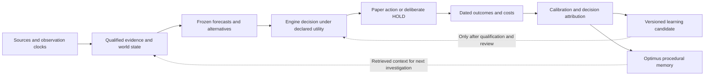
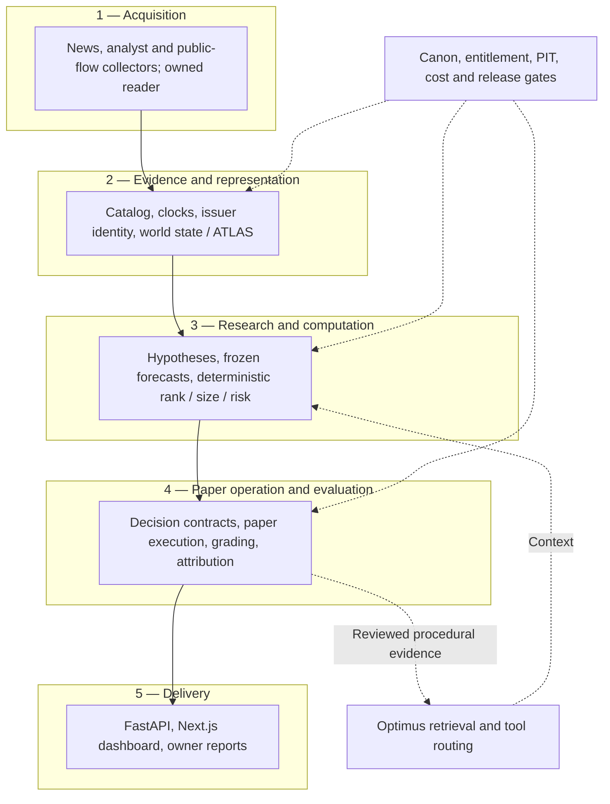
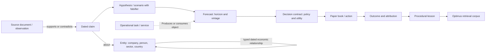

# Owner notes, October 27–31: system and evidence

Prepared 2026-11-04 against `origin/main` at `6dc083fff6a00b2edaaa7d18d6df36c3dccd394b`.
**Result improvement: none; documentation only.** This reconciles seven topics supplied in the owner's document-builder request; the original Oct 27–31 note text was not located in the inspected sources. Dates identify the requested note window, not verified note authorship or runtime freshness. No new roadmap, experiment registration, activation or market-performance claim follows.

Source baseline: [AGENTS](../../AGENTS.md), [CLAUDE](../../CLAUDE.md), [canon](../CANON.md), [negative results](../../NEGATIVE_RESULTS.md), [existing pipeline](../AEGIS_V1_BETA_2026-10-07.md), [module architecture](../assets/architecture_pipeline.svg), [Optimus objective](../OPTIMUS_OBJECTIVE.md), and [MCP query surface](../OPTIMUS_MCP_SURFACE.md). These are design and dated implementation evidence, not proof of current operation.

The [owner-review reconciliation](../../../aegis-worktrees/beta-v2-owner-20261025/docs/beta_v2/OWNER_REVIEW_RECONCILIATION_2026-10-26.md) is an existing **local sibling-worktree source**, absent from this base commit; its link works in this workspace but is not portable to a standalone clone. It maps requests to C00–C15/B01 and R001–R146. Mapped does not mean implemented. Owners below are responsible **roles proposed for answering existing questions**, not claims that named people accepted assignments.

## 1. Feedback loop

**Exists:** the [eight-stage pipeline](../AEGIS_V1_BETA_2026-10-07.md) and [nine-stage module view](../assets/architecture_pipeline.svg) describe the same chain; the latter separates world-state/theory from evidence. Existing modules include forecast grading, regret/decision stories and policy state. The October 7 snapshot explicitly reported policy state as write-only and decision stories as dry-run-only; those findings must not be silently upgraded to a closed loop today.

**Unanswered test / owner:** C02/C11/C15, runtime operator plus learning maintainer: can one naturally scheduled chain join source ID, forecast vintage, action/HOLD, matured outcome, attribution, changed policy version and its subsequent consumer read? A file write, successful process or synthetic example alone cannot answer this. Keep forecast accuracy, decision utility, execution quality and coverage separate.

## 2. Layered technical architecture

**Exists:** [repo/service boundaries](../../AGENTS.md), the [pipeline module inventory](../assets/architecture_pipeline.svg), and the [read-only MCP query layer](../OPTIMUS_MCP_SURFACE.md). Layers summarize responsibilities rather than introduce services. Optimus transport belongs to the sibling Optimus repo; Aegis numerical-data query logic stays beside its data. Offline research and execution repositories have separate authority and histories ([operating model](../CODEX_OPERATING_MODEL.md)).

**Unanswered test / owner:** C05/C15, data maintainer and runtime operator: for each claimed integration, which actual caller consumes which versioned output, with what latency, entitlement and failure state? Test missing/stale/empty inputs as explicit unavailable/refused states; never substitute zero. An architecture edge does not certify a deployed connection.

## 3. Object relationships

This is a conceptual relationship map, not an implemented database schema or cardinality claim. **Exists:** the owner reconciliation's C06/R052–R061 distinguishes economic ATLAS from its paper-account consumer and from the operational task namespace. The [ATLAS v3 portfolio review](../ATLAS_LLM_PORTFOLIO_V3_2026-10-10_REVIEW.md) is an inactive, dated portfolio proposal; its existence does not prove a complete economic graph. [World-state and forecast modules](../assets/architecture_pipeline.svg) supply existing building blocks.

**Unanswered test / owner:** C06/C14, entity/data maintainer: can one issuer dossier trace source → claim → typed relationship → thesis → decision without collapsing issuer, instrument, exchange or currency? Preserve contradictory claims and validity/availability clocks. A graph edge is an asserted relationship, not established causality; drawing one does not qualify it for sizing.

## 4. Business-model canvas

This canvas organizes the existing [three-deliverable mission](../OPTIMUS_OBJECTIVE.md) and owner reconciliation B01/R139–R146. Commercial entries remain hypotheses, with no verified customer demand or revenue implied.

| Canvas block | Existing basis / unresolved question |
|---|---|
| Customer segments | Owner as first user; other self-directed open-source users are intended. Which external segment has a demonstrated unmet need? |
| Value proposition | Traceable research, decisions, alternatives and outcomes under a declared utility. Does a user complete a useful decision workflow with less effort? No return promise. |
| Channels | Existing dashboard, repository and owner reports. Which channel reaches actual repeat users? |
| Relationships | Owner collaboration and reproducible open-source use. Support needs and retention are unmeasured. |
| Revenue | No validated monetization in these sources. Who pays, for what, and at what price remains open. |
| Key resources | Code, qualified evidence, procedural memory and forward record. Data access does not imply redistribution rights. |
| Key activities | Collection, qualification, research, paper evaluation, attribution and explanation. Operational completion needs receipts. |
| Key partners | Data/infrastructure providers; conditional HKU research aim. Access is not venture backing, endorsement or a commercial partnership. |
| Cost structure | Hosting, inference, data, hardware and operator time. Unit cost per useful completed workflow is not established here. |

**Unanswered test / owner:** B01, owner/business lead: identify the intended external user and obtain direct evidence of workflow usefulness, willingness to pay and service cost before treating the canvas as validation. This document neither schedules outreach nor authorizes messages.

## 5. Inclusion data

**Meaning unresolved:** the supplied phrase could mean dataset coverage/selection, index membership or inclusion criteria for evidence. It must not be silently interpreted as demographic data or a new investment signal. Existing C05/R044–R051, C09/R086 and C14/R124–R132 already cover identifiers, historical membership and explained exclusions in the owner reconciliation; the [query surface](../OPTIMUS_MCP_SURFACE.md) documents decision-time filtering and counted missing anchors.

**Unanswered test / owner:** owner clarifies the intended meaning; data maintainer then demonstrates a dated eligible-universe denominator, included/excluded/missing counts with reasons, identifier mapping, availability clocks, entitlements and a named downstream read. Historical membership snapshots stay immutable; vendor corrections receive separate versions. Unknown coverage is not zero coverage, and downloaded data is not proof of use.

## 6. Word2vec and numerical vectors

A word embedding represents a token as a numerical vector; document representations require an explicit construction beyond that token vector. Illustrative only: `v(token) = [0.12, -0.40, 0.07]`. These invented coordinates are not Aegis outputs, percentages or economic exposures. Similarity depends on the representation and metric; it is neither a calibrated probability nor a trading weight. Graph-edge weights, learned coefficients, confidence estimates and portfolio allocations are separate typed quantities.

**Exists:** prior text-method comparisons are discussed in the [event-return research note](../research_notes/2026-09-13/research_event_returns_last_read.md); that mention does not establish a deployed word2vec encoder. The inspected architecture and reconciliation do not prove one is installed or admitted to decisions.

**Unanswered test / owner:** C12/C05, representation maintainer and independent evaluator: identify the actual encoder/version, vocabulary, dimensions, training provenance and decision-time availability; reproduce nearest-neighbor results and assess unseen retrieval cases against the existing lexical baseline. Any probability requires its own target, horizon and calibration evidence; any sizing use requires the existing registered evidence and risk gates. No new training run or strategy is proposed here.

## 7. Optimus as RAG

Optimus is a retrieval-augmented context layer: persisted source material → bounded retrieval → source-linked context → model answer. Its [documented query surface](../OPTIMUS_MCP_SURFACE.md) exposes typed read-only access, bounded replies, provenance and explicit missing-input states; [process memory in canon](../CANON.md) explains why lessons are retained. The surface is one component of Optimus, not proof that every retrieval tool uses the same implementation.

Retrieval supplies information at inference time; it does **not** train or fine-tune model parameters. RAG need not use vectors, and calling Optimus RAG does not establish a vector database, word2vec implementation or semantic-retrieval quality. Saving or ingesting a note proves neither retrieval nor correct use of it.

**Unanswered test / owner:** C00/C12/R106–R117, Optimus maintainer plus independent reviewer: ingest a sanitized, versioned source through the existing workflow, retrieve it with a distinctive query, inspect the exact cited source/version, then test an unseen paraphrase, contradiction, stale version and absent answer. Record retrieval coverage, citation correctness and abstention separately from any downstream decision value. No ingestion or runtime mutation is performed by this document.
