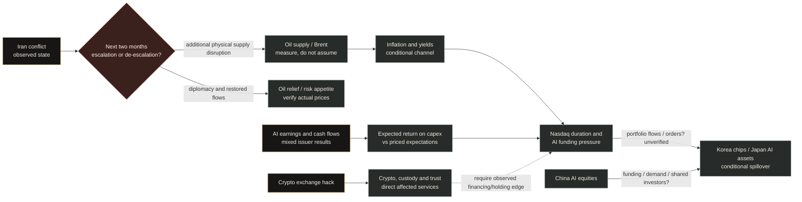

# AEGIS macro stations | 5 Nov 2026

Status: dated analyst scenario map, assembled after source checks at **5 Nov 07:33–07:35 UTC**; **inactive**, not a calibrated forecast, a live Brain update, a trading instruction, or evidence of owner delivery. Source clocks, collection clocks, and the saved holdings clock differ.

## What the existing universe currently means

The saved stock proxy contains 17,261 listing keys (3,734 US; membership unconfirmed). **Separate saved local witness, read 5 Nov 07:46 UTC:** `backend/data/optimus/world_state/beliefs.json` (SHA-256 `cef6dc1b0a130d04`) and `scenarios.json` (`8b82fcb68c33d0e6`) both report as-of **3 Nov 14:12 UTC**; the latter lists eight 2027/2030 scenarios. `backend/services/world_state.py` labels the belief lines `co_mention_edges`: co-mentions, **not** validated causal links. This saved state is not a simultaneous live market or owner-decision observation. The proposed two-month stations below need an event-to-belief-to-holding evidence contract before activation. The natural world-digest attempts inspected on 4 Nov refused at shared-budget preflight. No matching event-to-owner delivery has been proved.

## Conditional pathways

An election result changes legislative bargaining and policy incentives; it does not itself remove the US president or settle the Iran conflict. [AP called Democratic control of both chambers on 4 Nov](https://apnews.com/article/b1d26390b7ed7968435089be6d3bf612); certified totals and operative policy are later facts. The new Congress starts 3 Jan 2027. [On 4 Nov, the S&P 500 rose 1.6%, Nasdaq 1.4%, and Brent was below $95](https://apnews.com/article/stock-markets-ai-earnings-oil-4d12764c0b3ce38ffde3077712811182), an immediate counterexample to a one-way event-to-market rule. A rising oil price may benefit some producers while hurting importers, travel and rate-sensitive assets; which effect dominates the Nasdaq is an empirical question. AI earnings are issuer-specific rather than uniformly negative.

## Evidence and decision rules for each station

| Station | Observed anchor | Two-month branch to monitor | Falsifier or rival explanation | Exposure status |
|---|---|---|---|---|
| Iran / oil | Existing conflict; [EIA on 3 Nov](https://www.eia.gov/TodayinEnergy/detail.php?id=68404) reports 2Q disruption and 3Q partial recovery | New supply disruption vs diplomacy/restored flows | War rhetoric without additional supply loss; offsetting OPEC/supply response | No direct held-oil issuer established from saved PC snapshot; broad portfolio effect unquantified |
| US election / policy | Election outcome and dated enacted rules separately | Permitting/energy/AI policy changes | Campaign position never becomes law, or company projects elsewhere | Data-center names are candidates pending project-level links |
| AI profitability / funding | Mixed results, capex and debt/equity terms | Slower monetisation plus financing pressure vs resilient cloud demand | Strong returns on investment, positive cash conversion, expectations already discounted | Held AMD, AMZN, META, NVDA and others need issuer-specific reviews |
| Japan / Korea | BOJ reports stable Japanese intermediation; BOK reports financial pressure while its [October economic update](https://www.bok.or.kr/eng/bbs/E0000634/view.do?menuNo=400069&nttId=11065826) expects chip-led growth | Asset repricing or funding strain vs export strength/capital buffers | No bank distress and continued earnings growth | Contagion hypothesis; no verified held regional security edge |
| Indonesia | [BI/KSSK 3 Nov](https://www.bi.go.id/id/publikasi/ruang-media/news-release/Pages/sp_2824026.aspx) reports equity outflows, rupiah and liquidity pressure alongside Q3 system stability | Outflows/FX pressure vs policy stabilisation | Bond inflows, reserves or improved funding | Indirect global-risk channel only |
| China AI | [Reuters' reporter-calculated mainland STAR50 decline](https://www.marketscreener.com/news/in-china-the-ai-bubble-has-already-burst-ce785cdcda89f027); breadth, valuations and funding still require separate measurement | Sector drawdown vs rotation/normalisation | Official closes and issuer orders stabilize | Supply-chain/customer links need validation; STAR50 is not all China AI |
| Crypto hack | Binance's **company-reported** Oct 29 incident; its 3 Nov report says $6.34bn affected, 98% of affected token assets replenished and $2.85bn frozen/intercepted | Exchange liquidity/trust stress vs contained replenishment | Withdrawals/reconciliation recover and contagion fails to appear | Saved RSS row falsely tags held `TGT`; held **NYSE-listed** `XYZ` has general bitcoin-business risk, not a verified Binance-loss or Nasdaq constituent edge |

Potential is a **research queue**, not a buy list: oil producers versus import-sensitive travel under a *verified incremental* oil supply shock; Korean memory and Japanese equipment under *continued* AI order growth; resilient firms with positive AI cash conversion if broad selling indiscriminately reprices them; and cybersecurity vendors if the exchange incident translates into signed demand. For each candidate, first measure revenue/geography, expectations already in the price, liquidity and a matched control. The same branches can reverse those opportunities. There is no demonstrated Nasdaq-wide directional edge or short rule here.

**Analyst provisional stance at this review cutoff:** I judge two-sided event risk worth monitoring through 5 Jan 2027; this is qualitative and has **no measured baseline or calibrated probability**. These sources do not establish that the Nasdaq will fall, that oil will rise, or that a broad short has a positive expected return. Review any technology concentration against the owner's declared loss budget and update on physical oil flows, fuel prices, company cash conversion and funding, Asian credit/FX releases, and verified crypto contagion. The saved PC snapshot at 5 Nov 00:04:58 UTC puts the *candidate* data-center group AMD+AMZN+DELL+META+NVDA at 8.662% of equity; this is a hypothesis overlay, not a continuously reconciled position or event loss estimate. No order, paper rebalance or owner delivery is implied.

Existing AEGIS research also cuts against using geopolitical fear alone as a short trigger: [`NEGATIVE_RESULTS.md` §15](../../../NEGATIVE_RESULTS.md) records that historical GPR spikes were **not** an adoptable sell signal, while an oil response faded in that test. Those descriptive historical results are not a two-month forecast for this conflict. A new oil/market strategy would require a preregistered trial with matched controls and realistic execution.

**Decision gates:** a source can enter an **inactive provisional assessment** with first-seen/source clocks, a stated mechanism, counterevidence and explicit UNKNOWN labels for missing identity, holdings, forecast or delivery. A missing report must not silence a bounded review. **Activation** as a held-security warning requires a reviewed identity/exposure edge and a source-bound decision receipt. A delivered-warning claim additionally requires its own native transport/owner receipt. The E1 subject gate has passed independent *local* review; E2 receipt writer has not yet passed its correction review. Neither is in the running digest. Never fill a missing link with a fabricated probability or trade.

## Visual adoption contract

The existing `/brain` orbs represent topic beliefs and its lines represent co-mentions. A causal station must use a different, explicitly typed edge: `OBSERVED_FACT`, `SCENARIO_MECHANISM`, `ISSUER_EXPOSURE`, or `CONTRADICTION`, each carrying its own source IDs and cutoff; observed and issuer edges require qualified dated evidence. Draw unverified exposure as a hollow node and an untested mechanism as a dashed line. A station tooltip should show source publication and AEGIS first-seen clocks, observation horizon, counterevidence, exact held-security match status, last forecast/review ID or UNKNOWN, and owner-delivery status or NOT_ATTEMPTED. Never size a bubble from an LLM's unscreened confidence or make proximity imply correlation. Give agents an append-only candidate queue; only reviewed evidence can replace an active station state. This is a **proposed** extension of roadmap C17/C11 after the event-to-owner chain is demonstrated.

## Current primary sources

- [Bank of Japan, Financial System Report, 23 Oct 2026](https://www.boj.or.jp/en/research/brp/fsr/fsr261023.htm): system stable under its stress tests; AI return expectations, nonbank funding and Middle East energy are interacting risks.
- [Bank of Korea, monetary-policy remarks, 22 Oct 2026](https://www.bok.or.kr/eng/bbs/E0000634/view.do?menuNo=400069&nttId=11065825): strong export/investment growth, around 3% inflation and financial-stability risks, including AI-stock volatility.
- [IMF, Global Financial Stability Report, 13 Oct 2026](https://www.imf.org/en/Publications/GFSR/Issues/2026/10/13/global-financial-stability-report-october-2026): AI asset corrections, sovereign-yield shocks and cyber threats can interact with leverage and concentration.
- [Binance, preliminary incident report, 3 Nov 2026](https://www.binance.com/en/square/post/384328127385979): approximately $6.34bn assets affected; it reports replenishment and frozen/intercepted funds. The company report is not proof of system-wide contagion.

Source and clock packets: Iran, election and oil (`C:\Users\mrthn\aegis-recovery-evidence\macro-iran-election-20261105-r1\REPORT.md`); Asia, China and crypto (`C:\Users\mrthn\aegis-recovery-evidence\macro-asia-crypto-20261105-r1\REPORT.md`); post-election news map (`C:\Users\mrthn\aegis-recovery-evidence\post-election-news-map-20261105-r1\REPORT.md`); event-to-owner trace (`C:\Users\mrthn\aegis-recovery-evidence\event-to-owner-trace-20261105-r1\REPORT.md`). The local Binance RSS line is `google_news_rss_en_gb/2026-11-01.jsonl:16`, first seen **04:39:46 UTC** and SHA-256 prefix `7e78e433027dcb74`. It tags `TGT` without Target issuer evidence. The saved PC snapshot at **5 Nov 00:04:58 UTC** holds both `TGT` and `XYZ`; a false ticker join could create a spurious direct holding review. Verify source subject before any event-to-portfolio bridge.
